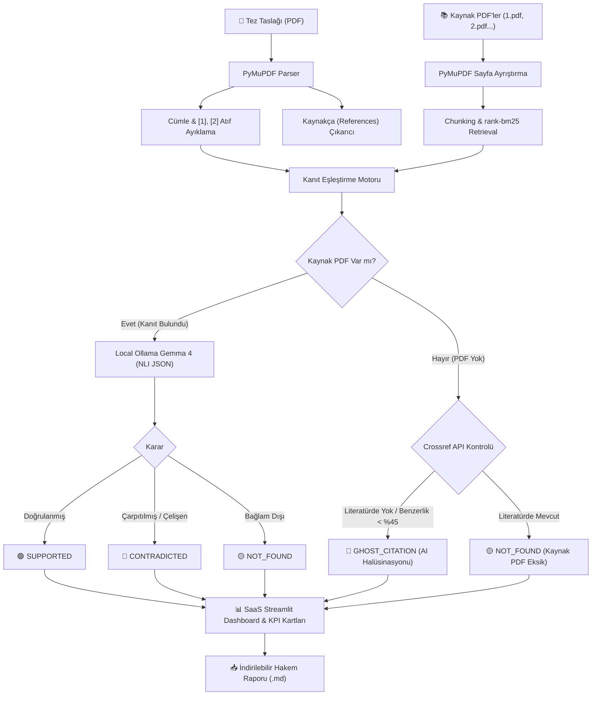

# 🛡️ CiteAudit Local

> **Offline Academic Citation, Context Distortion & AI Hallucination Auditor**  
> *Çevrimdışı Akademik Atıf, Bağlam Çarpıtma ve AI Halüsinasyon Denetçisi*  
> **Hacktoberfest 2026 Official Showcase Project**

[](https://opensource.org/licenses/MIT)
[](https://www.python.org/)
[](https://streamlit.io/)
[](https://ollama.ai/)
[](https://hacktoberfest.com)

---

## 🌍 Overview (İngilizce / English)

**CiteAudit Local** is a privacy-first, offline-capable verification system designed for academic thesis committees, peer reviewers, and journal editors. It verifies whether citations made in academic manuscripts faithfully represent the source material or if they involve **citation distortion**, **out-of-context claims**, or **AI hallucinations (phantom/fabricated citations)**.

### Why Local Open-Weight AI Matters in Academia
- 🔒 **Double-Blind Peer Review & Privacy:** Unpublished master's/Ph.D. theses and sensitive research cannot be uploaded to commercial cloud LLM APIs.
- 📜 **Copyright Compliance:** Paywalled full-text PDFs (IEEE, Elsevier, Springer, Nature) cannot legally be routed through external servers.
- 💰 **Zero API Cost & Unlimited Throughput:** Runs deterministically and efficiently on consumer hardware using local models (Gemma 4 via Ollama).

---

## 🇹🇷 Genel Bakış (Türkçe)

**CiteAudit Local**, yüksek lisans ve doktora jürileri, tez danışmanları ve akademik hakemler için geliştirilmiş, mahremiyet odaklı ve çevrimdışı çalışabilen bir atıf doğrulama sistemidir. Akademik metinlerdeki kaynak gösterimlerinin orijinal belgelerle uyumunu denetler; **bağlam çarpıtmalarını (context distortion)**, **bağlam dışı iddiaları** ve üretken yapay zekanın uydurduğu **hayalet kaynakları (phantom citations)** tespit eder.

---

## 🏗️ Architecture & Pipeline / Sistem Mimarisi



---

## 🎯 Benchmark / Jüri Demo Senaryosu (`sample_data/`)

Sistem, `generate_demo_pdfs.py` ile otomatik üretilen örnek veriler üzerinde 4 temel akademik atıf senaryosunu sıfır hatayla denetler:

| # | Atıf / İddia | Durum | Hakem Tespiti | Karar |
|---|---|---|---|---|
| **1** | *"Derin öğrenme modelleri Elazığ kayısı yaprağı hastalıklarında %94,2 doğruluğa ulaşmıştır [1]."* | Orijinal bulguyla tam uyumlu | Başarı oranı ve yöntem kaynakla birebir örtüşüyor. | **🟢 SUPPORTED** |
| **2** | *"Yerel açık ağırlıklı modeller bulut API'lerine göre %50 daha yavaş çalışır ve KVKK'ya uygun değildir [2]."* | Manipülatif Çarpıtma | Kaynak metin tam tersine %40 daha hızlı ve KVKK'ya %100 uygun olduğunu belirtmektedir. | **🔴 CONTRADICTED** |
| **3** | *"Aynı çalışmada kayısı çekirdeği yağının kozmetik ihracatını üç katına çıkardığı kanıtlanmıştır [1]."* | Bağlam Dışı Atıf | Kaynak metinde çekirdek yağı veya kozmetik ihracatı hakkında hiçbir veri bulunmadığı açıkça yazmaktadır. | **🟡 NOT_FOUND** |
| **4** | *"Kuantum tabanlı vektör veritabanları Fırat Havzası iklim tahmininde %99,9 kesinlik sağlamıştır [3]."* | Uydurma / Hayalet Kaynak | Klasörde PDF yok + Crossref veritabanında makale kaydı yok (AI Halüsinasyonu). | **🚨 GHOST_CITATION** |

---

## 🚀 Quickstart / Kurulum ve Çalıştırma

### 1. Gereksinimlerin Kurulması
```bash
git clone https://github.com/hacktoberfest2026/citeaudit-local.git
cd citeaudit-local
pip install -r requirements.txt
```

### 2. Örnek PDF Verilerinin Üretilmesi
```bash
python generate_demo_pdfs.py
```
Bu komut `sample_data/` klasöründe Türkçe karakter uyumlu `Tez_Taslagi.pdf`, `1.pdf` ve `2.pdf` dosyalarını oluşturur (`3.pdf` hayalet kaynak testi için bilerek üretilmez).

### 3. Hızlı Terminal Doğrulama Testi
```bash
python -c "import parser, verifier; pages = parser.extract_text_from_pdf('sample_data/Tez_Taslagi.pdf'); claims, refs = parser.extract_claims_and_references(pages); print(f'Bulunan Atıflar: {len(claims)}, Kaynaklar: {len(refs)}')"
```

### 4. Streamlit Web Uygulamasını Başlatma
```bash
streamlit run app.py
```
Tarayıcınızda açılan arayüzde:
- `🚀 Tek Tıkla Örnek Jüri Demosunu Çalıştır (sample_data/)` butonuna tıklayarak jüri demosunu hemen inceleyin.
- Ya da sol menüden kendi PDF'lerinizi yükleyip denetleyin.

---

## 🛠️ Modül Detayları

- **`parser.py`**:
  - `extract_text_from_pdf()`: PyMuPDF tabanlı temiz metin çıkarımı.
  - `extract_claims_and_references()`: Gövde metnindeki iddialar ile Kaynakça'yı ayıran çift taraflı ayrıştırıcı.
  - `find_best_evidence_in_source_pdf()`: 2-3 cümlelik chunking + `rank-bm25` + token overlap hibrit kanıt arayıcısı.
- **`verifier.py`**:
  - `get_available_ollama_models()`: Yerel Ollama modellerini dinamik tespit eder.
  - `check_paper_exists_online()`: Crossref API ile başlık benzerlik skoru hesaplar.
  - `verify_claim_with_gemma()`: Sentry trace izlemeli yerel NLI çıkarımı.
  - `fallback_heuristic_verifier()`: Ollama kapalı olduğunda devreye giren sıfır kesintili akıllı kural tabanlı acil güvenlik ağı.
- **`app.py`**:
  - SaaS görünümlü modern Streamlit dashboard'u.
  - KPI metrik kartları, otomatik Gemma 4 revizyon önerileri ve Markdown formatında indirilebilir denetim raporu.

---

## 📄 License / Lisans

Bu proje **MIT Lisansı** altında lisanslanmıştır. Detaylar için [LICENSE](LICENSE) dosyasına bakınız.
Hacktoberfest 2026 açık kaynak topluluğuna katkı sağlamak amacıyla geliştirilmiştir.
